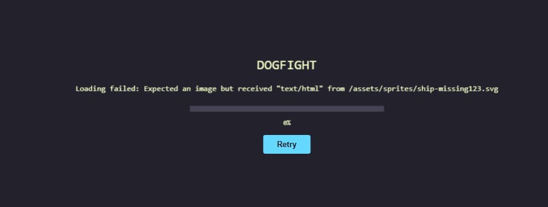
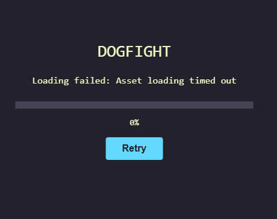

# Dogfight — Lab 03: Asynchronous JavaScript, Asset Loading, and Web Audio

## Опис проєкту

Браузерна гра на JavaScript Canvas 2D, що продовжує Lab 01 та Lab 02.

Проєкт демонструє роботу з асинхронним JavaScript: `Promise`, `async/await`, `fetch`, `AbortController`, `Promise.all`, microtasks і tasks. Також реалізовано завантаження ресурсів, Web Audio API, подієву архітектуру та Lobby з вибором ігрової арени.

## Запуск

Потрібні Node.js 24.21.0 або сумісна версія та npm.

```bash
npm install
npm run dev
```

Додаткові перевірки:

```bash
npm run lint
npm run format:check
npm run build
```

Після відкриття гри натисніть **Enable Audio & Start**, щоб дозволити браузеру використовувати Web Audio API.

## Керування

- `W` / `↑` — прискорення.
- `A` / `←` — поворот ліворуч.
- `D` / `→` — поворот праворуч.
- `Space` — стрільба або запуск ракети.
- `E` — перемикання між кулями та ракетами, якщо ракети є в запасі.

Підбирання pickup збільшує запас ракет. Ракети наводяться на астероїди. Зіткнення завдають шкоди, знищення астероїдів збільшує рахунок, а знищений корабель відроджується через 2 секунди.

## Архітектура

### Asset Pipeline

- `public/assets/manifest.json` — централізований перелік ресурсів.
- `src/assets/loader.js` — функції завантаження зображень, аудіо та JSON.
- `loadImage()` — завантаження зображень із використанням `Image.decode()`.
- `loadAudio()` — отримання аудіоданих і декодування через `decodeAudioData()`.
- `loadJson()` — отримання JSON через `fetchJson()` із перевіркою HTTP-статусу.
- `withRetry()` — повторні спроби з експоненційною затримкою та випадковим jitter. HTTP-помилки 4xx і скасовані операції не повторюються.
- `loadAll()` — паралельне завантаження ресурсів через `Promise.all()` з відстеженням прогресу.

Усі функції завантаження підтримують `AbortSignal`, що дозволяє скасовувати операції.

### Web Audio API та події

- `src/audio/audio.js` — аудіосистема, яка відтворює звуки пострілу, влучання та вибуху.
- `src/events/gameEvents.js` — централізована система ігрових подій на основі `EventTarget`.

Симуляція не залежить від аудіосистеми. Вона генерує події `fired`, `hit` та `exploded` через `CustomEvent`.

Аудіомодуль підписується на ці події та відтворює відповідні звуки.

`AudioContext` створюється після взаємодії користувача з кнопкою запуску, оскільки браузери обмежують автоматичне відтворення аудіо.

### Lobby

- `public/api/rooms.json` — статичне джерело конфігурацій кімнат.
- `src/lobby/lobby.js` — клас `Lobby extends EventTarget`, який завантажує кімнати, оновлює їх список і обробляє приєднання гравця.
- `src/lobby/lobbyView.js` — DOM-інтерфейс Lobby.
- `src/lobby/lobby.css` — оформлення інтерфейсу.

Lobby отримує список кімнат через `GET /api/rooms.json`, періодично оновлює його та використовує `AbortSignal.timeout()` для обмеження часу запиту.

Після натискання Join генерується подія `join`, яка передає ім'я гравця та конфігурацію вибраної кімнати в ігровий модуль.

Кімнати мають різні параметри:

| Кімната | Розмір арени | Кількість астероїдів |
|---|---:|---:|
| Training Arena | 1600 × 900 | 8 |
| Combat Zone | 2400 × 1400 | 18 |
| Survival | 3000 × 1800 | 30 |

Кімнати є локальними конфігураціями, а не мережевими multiplayer-сесіями.

### Ігрова симуляція

- `src/sim/vector.js` — `Vector2` з методами роботи з векторами.
- `src/sim/entity.js` — базовий `Entity`, унікальні ID, стан сутності та приватне здоров'я `#hp`.
- `src/sim/ship.js` — `Ship extends Entity`, керування, стрільба та запуск ракет.
- `src/sim/bullet.js`, `src/sim/missile.js`, `src/sim/asteroid.js`, `src/sim/pickup.js`, `src/sim/explosion.js` — ігрові сутності.
- `src/sim/world.js` — зберігання сутностей у `Map`, ітерація, `ofKind()` та відкладене видалення через `sweep()`.
- `src/sim/collision.js` — окрема система колізій, пошкодження та створення вибухів.
- `src/sim/homing.js` — поведінка наведення.
- `src/main.js`, `src/render/` — ігровий цикл, введення, відображення та HUD.

Наслідування обмежене одним рівнем: `Ship extends Entity`. Зіткнення обчислюються окремою системою з наївною складністю O(n²).

## Послідовне та паралельне завантаження

Послідовне завантаження виконує кожну операцію після завершення попередньої:

```js
const ship = await loadImage("/assets/ship.png");
const shot = await loadAudio("/assets/shot.wav");
const rooms = await loadJson("/api/rooms.json");
```

Якщо тривалість операцій становить 300, 500 та 200 мс, загальний час приблизно дорівнюватиме 1000 мс.

Паралельне завантаження дозволяє виконувати незалежні операції одночасно:

```js
const [ship, shot, rooms] = await Promise.all([
    loadImage("/assets/ship.png"),
    loadAudio("/assets/shot.wav"),
    loadJson("/api/rooms.json"),
]);
```

У цьому випадку загальний час буде приблизно 500 мс — тривалість найдовшої операції.

У проєкті використовується `Promise.all()` всередині `loadAll()`, оскільки завантаження окремих ресурсів не залежить одне від одного.

Це скорочує загальний час очікування, а callback `onProgress` дозволяє відображати поточний стан завантаження.

## Microtask та Task Puzzles

Наведені приклади демонструють порядок виконання синхронного коду, microtasks, tasks та `requestAnimationFrame`.

### Puzzle 1 — Promise та setTimeout

```js
console.log("A");

setTimeout(() => console.log("B"), 0);

Promise.resolve().then(() => console.log("C"));

console.log("D");
```

**Результат:**

```text
A
D
C
B
```

Пояснення: спочатку виконується синхронний код. Після нього обробляються microtasks (`Promise.then`), а потім tasks (`setTimeout`).

### Puzzle 2 — Promise всередині Promise

```js
console.log("A");

Promise.resolve().then(() => {
    console.log("B");

    Promise.resolve().then(() => {
        console.log("C");
    });
});

Promise.resolve().then(() => console.log("D"));

console.log("E");
```

**Результат:**

```text
A
E
B
D
C
```

Пояснення: `B` і `D` потрапляють до черги microtasks. Під час виконання `B` створюється нова microtask `C`, яка виконується після вже запланованої `D`.

### Puzzle 3 — async/await

```js
async function run() {
    console.log("A");

    await Promise.resolve();

    console.log("B");
}

console.log("C");

run();

console.log("D");
```

**Результат:**

```text
C
A
D
B
```

Пояснення: `await` призупиняє виконання async-функції до завершення Promise. Продовження функції виконується як microtask.

### Puzzle 4 — setTimeout всередині then

```js
console.log("A");

Promise.resolve().then(() => {
    console.log("B");

    setTimeout(() => console.log("C"), 0);
});

setTimeout(() => console.log("D"), 0);

Promise.resolve().then(() => console.log("E"));

console.log("F");
```

**Результат:**

```text
A
F
B
E
D
C
```

Пояснення: microtasks `B` та `E` виконуються раніше за tasks. Таймер `D` був запланований раніше за таймер `C`, тому виконується першим.

### Puzzle 5 — requestAnimationFrame

```js
console.log("A");

requestAnimationFrame(() => {
    console.log("B");

    Promise.resolve().then(() => console.log("C"));
});

Promise.resolve().then(() => console.log("D"));

setTimeout(() => console.log("E"), 0);

console.log("F");
```

**Результат (типовий порядок у браузері):**

```text
A
F
D
E
B
C
```

Пояснення: синхронний код виконується першим, потім microtask `D`. У типовому випадку таймер `E` виконується до наступного кадру, після чого викликається `requestAnimationFrame`. Microtask `C` виконується після callback `B`.

Примітка: точний момент виконання `requestAnimationFrame` залежить від циклу рендерингу браузера, частоти кадрів і моменту запланованого callback.

## Failure Gallery — обробка помилок завантаження

У цьому розділі продемонстровано поведінку системи завантаження ресурсів у разі виникнення помилок. Для кожного сценарію навмисно створювалася проблема, після чого перевірялася реакція Loading Screen та можливість відновлення роботи гри.

### 1. Відсутній спрайт (Missing Sprite)

**Сценарій:** шлях до зображення корабля в `manifest.json` було змінено на неіснуючий. Замість зображення сервер Vite повернув HTML-сторінку. Завантажувач виявив невідповідність `Content-Type` і повідомив про помилку.



**Помилка в консолі:**
```text
Expected an image but received "text/html"
```

**Відновлення:** Loading Screen відобразив повідомлення про помилку та кнопку Retry. Після відновлення правильного шляху до ресурсу повторне завантаження завершилося успішно.

### 2. Перевищення часу завантаження (Network Timeout)

**Сценарій:** для завантаження ресурсів було встановлено обмеження часу — 5 секунд. За допомогою емуляції повільного мережевого з'єднання було створено умови, за яких завантаження не вкладалося у встановлений час.



**Помилка в консолі:**
```text
TimeoutError: Asset loading timed out
```

**Відновлення:** після перевищення ліміту завантаження було перервано, а Loading Screen відобразив кнопку Retry. Після вимкнення обмеження швидкості мережі повторна спроба завершилася успішно.

### 3. Переривання завантаження (Abort Mid-load)

**Сценарій:** за допомогою `AbortController` завантаження ресурсів було примусово перервано через 1,5 секунди після початку процесу.


**Помилка в консолі:**
```text
AbortError: Loading aborted during the experiment
```

**Відновлення:** система коректно обробила скасування запитів, відобразила повідомлення про помилку та кнопку Retry. Після повторної спроби гра успішно завантажилася.

### 4. Пошкоджений JSON (Corrupt JSON)

**Сценарій:** у файлі `public/api/rooms.json` навмисно було допущено синтаксичну помилку — зайву кому після останньої властивості об'єкта. Це призвело до помилки під час парсингу JSON-відповіді.


**Помилка в консолі:**
```text
SyntaxError: Expected double-quoted property name in JSON
```

**Відновлення:** некоректна JSON-відповідь була відхилена, а Loading Screen показав повідомлення про помилку та кнопку Retry. Після відновлення правильного вмісту `rooms.json` повторне завантаження завершилося успішно, і Lobby знову відобразила доступні кімнати.

### Висновок

Усі чотири сценарії було перевірено практично. Система коректно реагує на помилки завантаження ресурсів і некоректні дані: замість аварійного припинення роботи користувач отримує зрозуміле повідомлення та можливість повторити спробу завантаження.