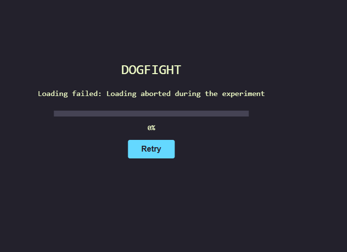
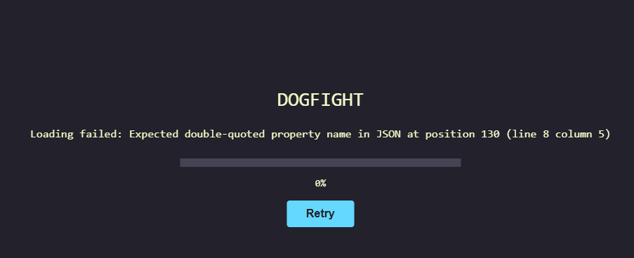
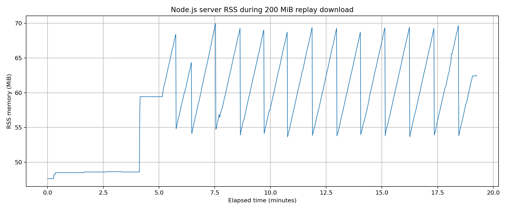

# Dogfight — JavaScript Labs: Browser Game, Node.js Server and Networking

[](https://github.com/ya-sa-29/dogfight/actions/workflows/ci.yml)

## Опис проєкту

Dogfight — браузерна гра на JavaScript Canvas 2D, яка розвивається в межах лабораторних робіт із JavaScript та Node.js.

Проєкт демонструє роботу з асинхронним JavaScript, завантаженням ресурсів, Web Audio API, подієвою архітектурою, HTTP-сервером, WebSocket-комунікацією, потоковою обробкою даних та керуванням навантаженням.

У межах лабораторних робіт реалізовано:

- Асинхронне завантаження ресурсів через `Promise`, `async/await`, `fetch`, `AbortController` та `Promise.all`.
- Web Audio API та централізовану систему ігрових подій.
- Lobby з вибором ігрової кімнати.
- HTTP-сервер на базі вбудованого модуля `node:http`.
- REST API для керування кімнатами та отримання записів матчів.
- WebSocket-комунікацію між гравцями.
- Запис подій матчів у форматі NDJSON та потокове відтворення записів.
- Backpressure, обмеження частоти повідомлень, контроль розміру повідомлень і захист від повільних клієнтів.
- Демонстрації Event Loop blocking та обробки помилок Node.js.

## Технології

- JavaScript (ES Modules).
- Node.js 24.21.0.
- HTML5 Canvas 2D.
- Web Audio API.
- Fetch API.
- WebSocket (`ws`).
- Node.js HTTP, Events та Streams.
- Vite.
- ESLint та Prettier.

## Запуск

Потрібні Node.js 24.21.0 або сумісна версія та npm.

Встановлення залежностей:

```bash
npm install
```

Запуск клієнта в режимі розробки:

```bash
npm run dev
```

Запуск сервера:

```bash
node --env-file=.env server/src/index.js
```

Якщо файл `.env` не використовується, сервер можна запустити без нього:

```bash
node server/src/index.js
```

Додаткові перевірки:

```bash
npm run lint
npm run format:check
npm run build
```

Після відкриття гри натисніть **Enable Audio & Start**, щоб дозволити браузеру використовувати Web Audio API.

## Керування

- `W` / `↑` — прискорення.
- `A` / `←` — поворот ліворуч.
- `D` / `→` — поворот праворуч.
- `Space` — стрільба або запуск ракети.
- `E` — перемикання між кулями та ракетами, якщо ракети є в запасі.

Підбирання pickup збільшує запас ракет. Ракети наводяться на астероїди. Зіткнення завдають шкоди, знищення астероїдів збільшує рахунок, а знищений корабель відроджується через 2 секунди.

---

# Lab 03 — Asynchronous JavaScript, Asset Loading, and Web Audio

## Архітектура клієнта

### Asset Pipeline

- `public/assets/manifest.json` — централізований перелік ресурсів.
- `src/assets/loader.js` — функції завантаження зображень, аудіо та JSON.
- `loadImage()` — завантаження зображень із використанням `Image.decode()`.
- `loadAudio()` — отримання аудіоданих і декодування через `decodeAudioData()`.
- `loadJson()` — отримання JSON через `fetchJson()` із перевіркою HTTP-статусу.
- `withRetry()` — повторні спроби з експоненційною затримкою та випадковим jitter. HTTP-помилки 4xx і скасовані операції не повторюються.
- `loadAll()` — паралельне завантаження ресурсів через `Promise.all()` з відстеженням прогресу.

Усі функції завантаження підтримують `AbortSignal`, що дозволяє скасовувати операції.

### Web Audio API та події

- `src/audio/audio.js` — аудіосистема, яка відтворює звуки пострілу, влучання та вибуху.
- `src/events/gameEvents.js` — централізована система ігрових подій на основі `EventTarget`.

Симуляція не залежить від аудіосистеми. Вона генерує події `fired`, `hit` та `exploded` через `CustomEvent`.

Аудіомодуль підписується на ці події та відтворює відповідні звуки.

`AudioContext` створюється після взаємодії користувача з кнопкою запуску, оскільки браузери обмежують автоматичне відтворення аудіо.

### Lobby

- `src/lobby/lobby.js` — клас `Lobby extends EventTarget`, який завантажує кімнати, оновлює їх список і обробляє приєднання гравця.
- `src/lobby/lobbyView.js` — DOM-інтерфейс Lobby.
- `src/lobby/lobby.css` — оформлення інтерфейсу.

Lobby отримує список кімнат через HTTP API `GET /api/rooms`, періодично оновлює його та використовує `AbortSignal.timeout()` для обмеження часу запиту.

Після натискання Join генерується подія `join`, яка передає ім'я гравця та конфігурацію вибраної кімнати в ігровий модуль.

Кімнати мають різні параметри:

| Кімната | Розмір арени | Кількість астероїдів |
|---|---:|---:|
| Training Arena | 1600 × 900 | 8 |
| Combat Zone | 2400 × 1400 | 18 |
| Survival | 3000 × 1800 | 30 |

### Ігрова симуляція

- `src/sim/vector.js` — `Vector2` з методами роботи з векторами.
- `src/sim/entity.js` — базовий `Entity`, унікальні ID, стан сутності та приватне здоров'я `#hp`.
- `src/sim/ship.js` — `Ship extends Entity`, керування, стрільба та запуск ракет.
- `src/sim/bullet.js`, `src/sim/missile.js`, `src/sim/asteroid.js`, `src/sim/pickup.js`, `src/sim/explosion.js` — ігрові сутності.
- `src/sim/world.js` — зберігання сутностей у `Map`, ітерація, `ofKind()` та відкладене видалення через `sweep()`.
- `src/sim/collision.js` — окрема система колізій, пошкодження та створення вибухів.
- `src/sim/homing.js` — поведінка наведення.
- `src/main.js`, `src/render/` — ігровий цикл, введення, відображення та HUD.

Наслідування обмежене одним рівнем: `Ship extends Entity`. Зіткнення обчислюються окремою системою з наївною складністю O(n²).

## Послідовне та паралельне завантаження

Послідовне завантаження виконує кожну операцію після завершення попередньої:

```js
const ship = await loadImage("/assets/ship.png");
const shot = await loadAudio("/assets/shot.wav");
const rooms = await loadJson("/api/rooms");
```

Якщо тривалість операцій становить 300, 500 та 200 мс, загальний час приблизно дорівнюватиме 1000 мс.

Паралельне завантаження дозволяє виконувати незалежні операції одночасно:

```js
const [ship, shot, rooms] = await Promise.all([
    loadImage("/assets/ship.png"),
    loadAudio("/assets/shot.wav"),
    loadJson("/api/rooms"),
]);
```

У цьому випадку загальний час буде приблизно 500 мс — тривалість найдовшої операції.

У проєкті використовується `Promise.all()` всередині `loadAll()`, оскільки завантаження окремих ресурсів не залежить одне від одного.

Це скорочує загальний час очікування, а callback `onProgress` дозволяє відображати поточний стан завантаження.

## Microtask та Task Puzzles

Наведені приклади демонструють порядок виконання синхронного коду, microtasks, tasks та `requestAnimationFrame`.

### Puzzle 1 — Promise та setTimeout

```js
console.log("A");

setTimeout(() => console.log("B"), 0);

Promise.resolve().then(() => console.log("C"));

console.log("D");
```

Результат:

```text
A
D
C
B
```

Пояснення: спочатку виконується синхронний код. Після нього обробляються microtasks (`Promise.then`), а потім tasks (`setTimeout`).

### Puzzle 2 — Promise всередині Promise

```js
console.log("A");

Promise.resolve().then(() => {
    console.log("B");

    Promise.resolve().then(() => {
        console.log("C");
    });
});

Promise.resolve().then(() => console.log("D"));

console.log("E");
```

Результат:

```text
A
E
B
D
C
```

Пояснення: `B` і `D` потрапляють до черги microtasks. Під час виконання `B` створюється нова microtask `C`, яка виконується після вже запланованої `D`.

### Puzzle 3 — async/await

```js
async function run() {
    console.log("A");

    await Promise.resolve();

    console.log("B");
}

console.log("C");

run();

console.log("D");
```

Результат:

```text
C
A
D
B
```

Пояснення: `await` призупиняє виконання async-функції до завершення Promise. Продовження функції виконується як microtask.

### Puzzle 4 — setTimeout всередині then

```js
console.log("A");

Promise.resolve().then(() => {
    console.log("B");

    setTimeout(() => console.log("C"), 0);
});

setTimeout(() => console.log("D"), 0);

Promise.resolve().then(() => console.log("E"));

console.log("F");
```

Результат:

```text
A
F
B
E
D
C
```

Пояснення: microtasks `B` та `E` виконуються раніше за tasks. Таймер `D` був запланований раніше за таймер `C`, тому виконується першим.

### Puzzle 5 — requestAnimationFrame

```js
console.log("A");

requestAnimationFrame(() => {
    console.log("B");

    Promise.resolve().then(() => console.log("C"));
});

Promise.resolve().then(() => console.log("D"));

setTimeout(() => console.log("E"), 0);

console.log("F");
```

Типовий результат:

```text
A
F
D
E
B
C
```

Пояснення: синхронний код виконується першим, потім microtask `D`. У типовому випадку таймер `E` виконується до наступного кадру, після чого викликається `requestAnimationFrame`. Microtask `C` виконується після callback `B`.

Примітка: точний момент виконання `requestAnimationFrame` залежить від циклу рендерингу браузера, частоти кадрів і моменту запланованого callback.

## Failure Gallery — обробка помилок завантаження

У цьому розділі продемонстровано поведінку системи завантаження ресурсів у разі виникнення помилок. Для кожного сценарію навмисно створювалася проблема, після чого перевірялася реакція Loading Screen та можливість відновлення роботи гри.

### 1. Відсутній спрайт (Missing Sprite)

**Сценарій:** шлях до зображення корабля в `manifest.json` було змінено на неіснуючий. Замість зображення сервер Vite повернув HTML-сторінку. Завантажувач виявив невідповідність `Content-Type` і повідомив про помилку.


Помилка в консолі:

```text
Expected an image but received "text/html"
```

**Відновлення:** Loading Screen відобразив повідомлення про помилку та кнопку Retry. Після відновлення правильного шляху до ресурсу повторне завантаження завершилося успішно.

### 2. Перевищення часу завантаження (Network Timeout)

**Сценарій:** для завантаження ресурсів було встановлено обмеження часу — 5 секунд. За допомогою емуляції повільного мережевого з'єднання було створено умови, за яких завантаження не вкладалося у встановлений час.


Помилка в консолі:

```text
TimeoutError: Asset loading timed out
```

**Відновлення:** після перевищення ліміту завантаження було перервано, а Loading Screen відобразив кнопку Retry. Після вимкнення обмеження швидкості мережі повторна спроба завершилася успішно.

### 3. Переривання завантаження (Abort Mid-load)

**Сценарій:** за допомогою `AbortController` завантаження ресурсів було примусово перервано через 1,5 секунди після початку процесу.



Помилка в консолі:

```text
AbortError: Loading aborted during the experiment
```

**Відновлення:** система коректно обробила скасування запитів, відобразила повідомлення про помилку та кнопку Retry. Після повторної спроби гра успішно завантажилася.

### 4. Пошкоджений JSON (Corrupt JSON)

**Сценарій:** у файлі `public/api/rooms.json` навмисно було допущено синтаксичну помилку — зайву кому після останньої властивості об'єкта. Це призвело до помилки під час парсингу JSON-відповіді.



Помилка в консолі:

```text
SyntaxError: Expected double-quoted property name in JSON
```

**Відновлення:** некоректна JSON-відповідь була відхилена, а Loading Screen показав повідомлення про помилку та кнопку Retry. Після відновлення правильного вмісту повторне завантаження завершилося успішно.

---

# Lab 04 — Node.js HTTP Server, WebSockets, Streams and Event Loop

## Архітектура сервера

Серверна частина реалізована на Node.js з використанням вбудованого модуля `node:http`. Для WebSocket-комунікації використовується бібліотека `ws`.

Сервер відповідає за:

- Обслуговування клієнтської частини гри.
- HTTP API для отримання та створення кімнат.
- Створення ігрових кімнат та керування підключеннями.
- Обмін повідомленнями між гравцями через WebSocket.
- Запис подій ігрових кімнат у файли NDJSON.
- Потокове передавання записів матчів.
- Обмеження навантаження та обробку помилок.

### HTTP Server

Основний сервер створюється за допомогою `createServer()` з модуля `node:http`.

У production-режимі сервер обслуговує файли клієнтської збірки з `client/dist`.

Реалізовано:

- Визначення MIME-типів для статичних файлів.
- Захист від Path Traversal під час обробки шляхів до файлів.
- Обробку невідомих маршрутів через HTTP 404.
- Обмеження розміру тіла HTTP-запитів.
- Перевірку та валідацію вхідних JSON-даних.
- Конфігурацію через змінні середовища `process.env`.

Для локальної розробки Vite використовує proxy для маршрутів `/api` та `/ws`, передаючи запити на Node.js-сервер.

### HTTP API

| Метод | Маршрут | Призначення |
|---|---|---|
| GET | `/health` | Перевірка стану сервера |
| GET | `/api/rooms` | Отримання списку кімнат |
| POST | `/api/rooms` | Створення нової кімнати |
| GET | `/api/replays/:id` | Потокове отримання запису матчу |
| GET | `/api/slow` | Демонстрація блокування Event Loop |

`POST /api/rooms` перевіряє отримані дані перед створенням кімнати. Розмір тіла запиту обмежений, а некоректні дані відхиляються.

### Graceful Shutdown

Сервер обробляє системні сигнали `SIGINT` та `SIGTERM`.

Під час завершення роботи:

1. Припиняється приймання нових HTTP-з'єднань.
2. Закриваються активні WebSocket-з'єднання.
3. Завершується робота серверних ресурсів.
4. Виконується завершення процесу з відповідним кодом виходу.

Це дозволяє уникати різкого припинення роботи сервера під час штатного завершення процесу.

## Rooms та WebSocket

### Room

Клас `Room` успадковує `EventEmitter` і представляє окрему ігрову кімнату.

Для зберігання підключених гравців використовується `Map`.

Кімната генерує події:

- `join` — приєднання гравця.
- `leave` — вихід гравця.
- `chat` — повідомлення в чаті.
- `empty` — кімната залишилася без гравців.

### RoomManager

`RoomManager` відповідає за життєвий цикл кімнат:

- Створення кімнат.
- Пошук кімнат за ідентифікатором.
- Зберігання кімнат у `Map`.
- Видалення порожніх кімнат після події `empty`.

### WebSocket lifecycle

WebSocket-сервер обслуговує маршрут `/ws`.

Після встановлення з'єднання клієнт повинен надіслати повідомлення `join` протягом 5 секунд. Якщо цього не відбувається, сервер закриває з'єднання.

Вхідні повідомлення проходять перевірку через `protocol.js`.

Перевіряються:

- Тип повідомлення.
- Структура та обов'язкові поля.
- Допустимі значення.
- Максимальний розмір повідомлення.

Невідомі типи та некоректні повідомлення призводять до закриття з'єднання.

Після приєднання сервер зберігає інформацію про гравця та його кімнату безпосередньо в об'єкті WebSocket-з'єднання.

Під час приєднання та виходу гравців сервер розсилає оновлений список учасників кімнати — `roster`.

Повідомлення чату передаються всім учасникам відповідної кімнати.

### Client WebSocket Connection

Клієнтська частина використовує окремий модуль `connection.js`.

Він відповідає за:

- Встановлення WebSocket-з'єднання.
- Відправлення повідомлень.
- Чергу повідомлень, які надходять до моменту встановлення з'єднання.
- Обробку вхідних повідомлень за їхнім `type`.
- Повторне підключення з експоненційною затримкою.

Для перевірки роботи WebSocket використовувалися два окремі вікна браузера.

Обидва клієнти приєднувалися до однієї кімнати, бачили один одного у списку гравців та могли обмінюватися повідомленнями в чаті.

### Heartbeat

Для виявлення неактивних WebSocket-клієнтів використовується механізм Ping/Pong.

- Сервер надсилає Ping кожні 15 секунд.
- Отримання Pong скидає лічильник пропущених відповідей.
- Якщо клієнт пропускає дві перевірки, з'єднання примусово завершується через `terminate()`.

Для кожного WebSocket-з'єднання також зареєстровано обробник події `error`.

## Match Logs та Node.js Streams

### Запис подій матчу

Кожна кімната має власний файл журналу подій матчу.

Для запису використовується формат NDJSON (Newline Delimited JSON): кожна подія зберігається як окремий JSON-об'єкт на новому рядку.

Приклади подій:

```json
{"t":1794859326662,"type":"join","playerId":"...","playerName":"Player 1"}
{"t":1794859327000,"type":"chat","playerId":"...","message":"Hello"}
{"t":1794859328000,"type":"leave","playerId":"..."}
```

Запис організовано через Node.js Streams:

- Події кімнати передаються в об'єктний `Transform`.
- `Transform` перетворює їх на NDJSON.
- Дані передаються через `pipeline()` до `createWriteStream()`.
- Файли зберігаються в директорії `LOG_DIR`.

Коли кімната стає порожньою, її журнал завершує запис.

### Replay

Модуль `replay.js` використовує асинхронний генератор для читання файлу матчу.

Він працює через:

- `createReadStream()` — потокове читання файлу.
- `readline.createInterface()` — обробку окремих рядків.
- `for await...of` — послідовне отримання рядків.
- `JSON.parse()` — перетворення рядків на JavaScript-об'єкти.

Такий підхід дозволяє обробляти великі файли без завантаження всього вмісту в оперативну пам'ять.

### Replay API

Маршрут:

```http
GET /api/replays/:id
```

знаходить файл запису відповідної кімнати та передає його клієнту через:

```js
pipeline(createReadStream(filePath), res);
```

Сервер не зчитує весь файл у пам'ять перед відправленням. Дані передаються потоково, а `pipeline()` керує передаванням даних і обробкою помилок потоків.

## Backpressure Test

Для перевірки потокової передачі було створено синтетичний NDJSON-файл розміром 200 MiB.

Файл завантажувався через браузер Chrome із використанням Network Throttling у DevTools.

Під час завантаження паралельно вимірювалося використання пам'яті серверним процесом Node.js (RSS).

Параметри експерименту:

- Розмір файлу: 200 MiB.
- Тривалість завантаження: приблизно 19,3 хвилини.
- Спосіб передавання: Node.js `pipeline()` та `createReadStream()`.
- Обмеження швидкості мережі: Chrome DevTools Network Throttling.

Результати вимірювань RSS:

| Показник | Значення |
|---|---:|
| Середнє використання пам'яті | 58,53 MiB |
| Мінімальне використання пам'яті | 47,65 MiB |
| Максимальне використання пам'яті | 69,95 MiB |
| Діапазон вимірювань | 22,3 MiB |



Під час експерименту сервер передавав великий файл без завантаження всього його вмісту в оперативну пам'ять.

Backpressure дозволяє потокам координувати швидкість передавання даних. Якщо споживач не встигає обробляти дані, потік може призупинити подальше читання, доки передавання не зможе продовжитися.

Отримані вимірювання демонструють, що використання пам'яті сервера залишалося в обмеженому діапазоні протягом завантаження 200 MiB файлу.

## Abuse Handling та захист WebSocket

Для захисту сервера від надмірної кількості повідомлень та перевантаження з'єднань реалізовано кілька обмежень.

### Rate Limiting

Для кожного WebSocket-з'єднання використовується Token Bucket.

Параметри:

- Швидкість поповнення: 10 токенів за секунду.
- Початковий запас: 20 токенів.
- Кожне вхідне повідомлення витрачає один токен.

Якщо клієнт перевищує встановлений ліміт, сервер закриває його з'єднання.

### Обмеження розміру повідомлень

WebSocket-сервер використовує `maxPayload` зі значенням 16 KiB.

Це обмежує максимальний розмір одного вхідного повідомлення та зменшує ризик надмірного споживання ресурсів.

### Обмеження кімнат і гравців

Встановлено такі обмеження:

| Параметр | Ліміт |
|---|---:|
| Гравці в одній кімнаті | 8 |
| Кімнати на сервері | 100 |

Якщо кімната заповнена або досягнуто загального ліміту кімнат, сервер відхиляє нове підключення до відповідного ресурсу.

### Slow Client Policy

Для виявлення клієнтів, які не встигають отримувати повідомлення, перевіряється `socket.bufferedAmount`.

Якщо обсяг даних, що очікують відправлення, перевищує 1 MiB, сервер закриває з'єднання з кодом `1013`.

Це дозволяє не накопичувати необмежену кількість повідомлень для повільного клієнта.

---

# Event Loop Demonstration

## Блокування Event Loop

Node.js використовує Event Loop для обробки асинхронних операцій і подій. Оскільки JavaScript-код виконується в одному основному потоці, довга синхронна операція може заблокувати обробку інших подій.

Для демонстрації реалізовано тестовий HTTP-маршрут:

```http
GET /api/slow
```

Обробник навмисно виконує синхронний busy loop приблизно 300 мс:

```js
const start = Date.now();

while (Date.now() - start < 300) {
    // Intentional blocking operation.
}
```

Під час тестування один клієнт надсилав HTTP-запит до `/api/slow`, а WebSocket-клієнт відправляв повідомлення в чат через 50 мс.

Приклад тесту в консолі браузера:

```js
const start = Date.now();

fetch('/api/slow');

setTimeout(() => {
    window.gameConnection.send({
        type: 'chat',
        message: 'Testing Event Loop blocking!'
    });

    console.log('Chat sent after:', Date.now() - start, 'ms');
}, 50);
```

Браузер відправляє WebSocket-повідомлення приблизно через 50 мс, однак сервер не може обробити його, поки виконується синхронна блокуюча операція.

Після завершення busy loop Event Loop продовжує обробку інших подій, і WebSocket-повідомлення надходить до кімнати.

**Висновок:** блокування Event Loop затримує не лише HTTP-запити, а й обробку інших з'єднань, зокрема WebSocket. Навіть коротка синхронна CPU-інтенсивна операція може негативно вплинути на відгук усього сервера.

## Node.js Event Loop: основні фази

Event Loop Node.js організований навколо кількох фаз:

- **Timers** — виконання callback-функцій таймерів.
- **Pending callbacks** — обробка деяких відкладених системних callback-функцій.
- **Poll** — отримання та обробка подій введення-виведення.
- **Check** — виконання callback-функцій `setImmediate()`.
- **Close callbacks** — обробка подій закриття з'єднань та інших ресурсів.

Microtasks, зокрема Promise callbacks, обробляються між відповідними етапами виконання JavaScript.

Синхронний код, який довго виконується, не дозволяє Event Loop перейти до обробки інших подій.

---

# Error Handling in Node.js

## Unhandled EventEmitter Error

У Node.js подія `error` має особливе значення для `EventEmitter`.

Якщо емітер генерує подію `error`, але на неї не зареєстровано обробник, Node.js викидає помилку та завершує процес.

Для демонстрації створено файл:

```text
server/src/error-demo.js
```

Запуск:

```bash
node server/src/error-demo.js emitter
```

У результаті отримано:

```text
Starting error demonstration: emitter
node:events:505
    throw er; // Unhandled 'error' event
    ^

Error: Something went wrong in EventEmitter
```

Процес завершується з ненульовим кодом виходу.

**Виправлення:** необхідно зареєструвати обробник події `error`.

```js
emitter.on('error', (error) => {
    console.error('Emitter error:', error);
});
```

## Unhandled Promise Rejection

Якщо Promise завершується відхиленням, але помилка не обробляється через `.catch()` або `try/catch`, виникає необроблений rejection.

Запуск:

```bash
node server/src/error-demo.js rejection
```

Результат:

```text
Starting error demonstration: rejection

Error: Something went wrong in Promise
```

У Node.js 24 за стандартної політики обробки необроблених Promise rejection процес завершується з помилкою.

**Виправлення:** необхідно обробляти відхилення Promise.

```js
Promise.reject(new Error('Something went wrong'))
    .catch((error) => {
        console.error('Promise error:', error);
    });
```

Або використовувати `try/catch` під час роботи з `async/await`.

## Практичне застосування в проєкті

У WebSocket-сервері для кожного підключення зареєстровано обробник:

```js
socket.on('error', (error) => {
    console.error('WebSocket error:', error);
});
```

Це дозволяє перехоплювати помилки конкретного з'єднання та не допускати аварійного завершення процесу через необроблену подію `error`.

Обробка помилок потоків також організована через `pipeline()`, який передає помилки між потоками та дозволяє централізовано обробляти їх.

---

# Lab 05 — Real-Time Networking: Authoritative Server, Prediction, and Binary Protocols

Лабораторна робота 05 перетворює гру на повноцінну мережову: два браузери, один авторитетний сервер, 30 Hz тики, клієнтське передбачення (prediction) із звіркою (reconciliation), інтерполяція віддалених об'єктів та бінарний протокол на `DataView`. Спільна симуляція винесена в окремий робочий простір `shared/`, який імпортують і клієнт, і сервер.

## M1 — Спільна симуляція, серверний tick, «dumb client»

- `shared/` містить чисту детерміновану симуляцію (`sim/`), seeded PRNG (`mulberry32`), протокол і кодек. Симуляція не використовує DOM, Canvas чи Node-built-ins і однаково працює у браузері та в Node.
- Сервер (`server/src/match.js`) виконує `World.step` з фіксованим `dt = 1/30` за схемою абсолютного таймера (`nextTickTarget += 1000/30; setTimeout(...)`), що прибирає дрейф і коалесценцію `setInterval`. Кожен тик генерує **snapshot** із `tick`, `serverTime`, `seed`, `entities` та `playerAcks` (останній оброблений `seq` для кожного гравця).
- Клієнт надсилає **inputs** (ніколи позиції) з `seq`; до появи авторитетного тика передача заблокована (`canSendInput`). Є інжектор латентності (base + jitter + drop, керований `?latency=`) та netgraph-оверлей (RTT, snapshot age, bytes/s, pending inputs, correction magnitude).

## M2 — Передбачення та звірка (prediction + reconciliation)

- Клієнт передбачає власний корабель через той самий `integrate`, що й сервер (`client/src/network/predictor.js`), 60 Hz для плавності.
- Кожен надісланий input зберігається в pending-буфері за `seq`; на кожному snapshot predicted-стан приводиться до авторитетного стану, а всі ще не підтверджені інпути (`seq > lastProcessedSeq`) відтворюються послідовно з кроком 1/30. Це наближає reconciliation до серверної моделі симуляції, однак не гарантує повної ідентичності, коли сервер обробляє декілька інпутів в одному тику.
- Корекція згладжується ~100 мс, щоб уникнути ривків (rubber-banding). У netgraph виводиться величина корекції.

## M3 — Інтерполяція та другий гравець

- Віддалені об'єкти (чужі кораблі, кулі, ракети) буферизуються і рендеряться на `interpolationDelay` у минулому (`client/src/network/interpolator.js`), що згладжує 30 Hz snapshots до частоти оновлення дисплея. Затримка (default 100 мс) показується в netgraph і регулюється live клавішами `[` / `]`.
- Власні локальні кулі передбачаються одразу (`client/src/network/bulletPredictor.js`) і зіставляються з авторитетними за просторовою близькістю (найближча в межах 24 px) з обмеженням one-to-one: одна авторитетна куля може підтвердити лише одну передбачену. Це запобігає повторному підтвердженню тієї самої кулі.

## M4 — Binary protocol and the measurements

### Binary codec (`DataView`)

Реалізовано компактний двійковий кодек для двох високочастотних повідомлень — `input` (client → server) та `snapshot` (server → client): `shared/codec/binaryCodec.js` (`encodeBinary` / `decodeBinary`). Формат **little-endian**, **версійований** (version 1), з квантизацією кута в `Int16` (1/1000 радіана). JSON-кодек (`shared/codec/jsonCodec.js`, `encode`/`decode`) збережено без змін і є транспортом за замовчуванням; бінарний транспорт вмикається прапорцем `?codec=binary` (див. «Transport integration» нижче).

**Схема формату (version 1), bytes:**

`input` (15 B):
```
0  Uint8  type=1
1  Uint8  version=1
2  Uint32 seq
6  Uint32 tick
10 Uint8  flags (bit0 thrust,1 turnLeft,2 turnRight,3 fire,4 switchWeapon)
11 Int32  clientBulletId (-1 = відсутній)
```

`snapshot`:
```
0  Uint8  type=2
1  Uint8  version=1
2  Uint32 tick
6  Float64 serverTime
14 Uint32 seed
18 Int32  score
22 Uint16 entityCount
24 Uint16 playerAckCount
   <entity>[entityCount]
   <playerAck>[playerAckCount]   // Uint16 len + UTF-8 id + Int32 seq
```

`<entity>`: `Uint32 id, Uint8 kindCode (1 ship,2 bullet,3 missile,4 asteroid,5 pickup,6 explosion), Uint8 flags(bit0 alive), Float32 x, Float32 y, Int16 angleQ (1/1000 rad, wrap [-π,π]), Float32 radius, Uint8 hp`, далі специфічні поля:
- `ship`: `Uint8 thrustFlag, Uint8 weaponCode (0 bullet,1 missile), Uint8 missileCount, Float32 fireCooldown, Float32 invulnerabilityTimer`
- `bullet` / `missile`: `Float32 ttl`
- `explosion`: `Uint16 particleCount` + per-particle `Float32 x,y,vx,vy,life,maxLife`
- `asteroid` / `pickup`: без додаткових полів

Round-trip: `decodeBinary(encodeBinary(msg))` відтворює повідомлення в межах квантизації (кут ±0.001 rad, позиції — точність `Float32`). Пошкоджені / обрізані / непідтримувані дані безпечно відхиляються (`CodecError`).

### Transport integration: JSON vs Binary flag

Транспорт **перемкнено** на вибір JSON або Binary через URL-прапорець `?codec=`:

- `?codec=json` (або без прапорця) — **JSON**-транспорт (як у M1–M3). Увесь обмін — JSON text-фрейми.
- `?codec=binary` — **Binary**-транспорт для data-plane повідомлень.

Поведінка в Binary-режимі:
- Клієнт встановлює `socket.binaryType = "arraybuffer"`, а `input` кодує через `encodeBinary` (`client/src/network/wire.js`).
- Сервер декодує вхідні бінарні фрейми через `decodeBinary` і надсилає `snapshot` у бінарному форматі для цього клієнта (`server/src/wire.js`, `sendMessage`).
- **Control-plane** повідомлення (`join`, `chat`, `leave`, `ping`/`pong`, `joined`, `roster`, `error`) **завжди** залишаються JSON text-фреймами в обох режимах — сумісність не порушується.

Узгодження режиму (mode negotiation): клієнт надсилає бажаний `codec` у `join`; сервер зберігає його на з'єднанні (`socket.transportCodec`) і повертає в `joined`. Snapshot кодується **для кожного отримувача окремо** за його узгодженим режимом, а вхідні фрейми авто-визначаються (бінарний → `decodeBinary`, текст → JSON). Тому два клієнти в одній кімнаті можуть використовувати різні режими без збоїв — кожне з'єднання узгоджує власний режим незалежно. Якщо клієнт просить режим, який сервер не підтримав, `joined.codec` відрізнятиметься, і клієнт виведе попередження в консоль.

Як запустити кожен режим:
- JSON: відкрити `http://localhost:5173/` (або `?codec=json`).
- Binary: відкрити `http://localhost:5173/?codec=binary`.

### JSON vs Binary (вимірювання)

Орієнтовні вимірювання (залежать від устаткування та конкретного snapshot) для репрезентативного випадку: 4 кораблі, 8 куль, 6 астероїдів, 1 pickup, 4 playerAcks (19 сутностей); input — один пакет; 30 Hz.

| Codec | Bytes/snapshot | KB/s per client (down) | KB/s per client (up) | Encode+decode |
|---|---|---|---|---|
| JSON | 2385 B | 69.9 KB/s | 3.49 KB/s | ~12 µs |
| Binary (`DataView`) | 669 B | 19.6 KB/s | 0.44 KB/s | ~10 µs |

- Snapshot: бінарний формат у ~3.6× менший (2385 → 669 B).
- Input: ~8× менший (119 → 15 B).
- CPU encode+decode для обох форматів порівнянний (основний виграш бінарного — розмір, а не швидкість).

### Netcode write-up

Три проблеми мережової гри та як їх вирішено в цьому проєкті:

1. **Латентність (latency).** При ~80 ms round-trip наївна схема «клієнт відповідає за власну позицію» дає затримку відгуку. Рішення — **client-side prediction**: клієнт одразу застосовує власний input до власного корабля через той самий детермінований `integrate`, що й сервер, тому корабель реагує миттєво.
2. **Узгодженість (consistency).** Через дрейф чи втрачені пакети клієнти бачать різні світи. Рішення — **authoritative server**: сервер виконує єдину симуляцію з фіксованим `dt = 1/30`, розсилає snapshots, а клієнт надсилає лише inputs. Детермінізм (seeded PRNG, відсутність `Math.random()`/`Date.now()` у sim) гарантує однаковий результат. **Reconciliation** повертає predicted-корабель до авторитетного стану і відтворює непідтверджені інпути; згладжування ховає корекції.
3. **Читинг (cheating).** Клієнт не може телепортуватися, бо надсилає лише inputs, а сервер валідує їх (`validateInputMessage`, перевірка `seq`, rate limiting) і ніколи не довіряє позиціям клієнта.

**Interpolation trade-off.** Віддалені об'єкти інтерполюються на `interpolationDelay` у минулому (default 100 мс ≈ 3 інтервали snapshot при 30 Hz). Це додає ~100 мс затримки для чужих кораблів, але прибирає 30 Hz смикання (stutter). Затримку можна регулювати live (`[` / `]`) і бачити в netgraph. Наслідок — при стрільбі по «видимій» позиції сервер знає, що ціль уже там немає; це компенсується lag compensation (поза межами лабораторної 05).

**Netgraph** — головний інструмент: RTT (ping/pong), snapshot age, bytes/s in/out, кількість непідтверджених inputs, величина корекції та інтерполяційна затримка. Показники до/після prediction демонструють різницю між «відгук через один round-trip» і «миттєвий відгук із непомітними корекціями у відкритому просторі».

---

# Lab 06 — TypeScript Migration

Лабораторна 06 переводить увесь first-party код (shared/, server/, client/) на TypeScript у strict-режимі з повним набором перевірок: `strict: true`, `noUncheckedIndexedAccess: true`, `noPropertyAccessFromIndexSignature: true`, `isolatedModules: true`, `composite: true`. Міграція виконана в три етапи (M1–M3) і не змінює поведінку гри чи протокол.

## Framework Decision — Why Vanilla DOM + Canvas Was Retained

Проєкт спеціально залишив vanilla DOM для lobby/HUD і Canvas 2D для ігрового циклу. Фреймворк (Svelte/Vue/React) **не мігрувався навмисно**. Причини:

- **Розмір пакета:** поточна клієнтська збірка (Vite production build) — ~138 kB (gzipped ~41 kB). Оціночно, додавання фреймворку + runtime збільшило б bundle на ~15–30 kB (gzipped) навіть при tree-shaking.
- **Складність збирання:** більшість фреймворків потребують Vite plugin, dev server інтеграції, HMR налаштування, TypeScript інтеграції для компонентів. Поточна збірка — один `vite.config.js` без плагінів.
- **Компоненти lobby/HUD:** ~300 рядків коду (Lobby, LobbyView, netgraph, HUD). Це не оправдовує abstraction cost фреймворку.
- **Життєвий цикл гри:** Canvas game loop (`requestAnimationFrame`, фіксований `dt`, ручне керування станом) не відображається на компонентну модель фреймворків. Спроба обгорнути Canvas у компонент створює impedance mismatch.
- Це свідома scope decision, а не незавершена робота. Якщо UI статиме складнішим (editor, replay viewer, складний settings panel), фреймворк можна оцінювати знову.

## What TypeScript Found — Migration Discoveries vs. Type-Safety Improvements

Міграція виявила кілька проблем у наявному коді ( Actual migration discoveries ) та ввів архітектурні покращення ( Type-safety improvements ), яких не було в JavaScript.

### Actual Migration Discoveries (issues in pre-migration code)

| Finding | Evidence | Explanation |
|---------|----------|-------------|
| **`ArrayBufferView.buffer` union** | `shared/codec/codec.ts:135,159` — `data.buffer as ArrayBuffer` | TypeScript виявив, що `.buffer` — `ArrayBuffer \| SharedArrayBuffer`. Код не обробляв `SharedArrayBuffer`; assertion прибрала небезпечний доступ. |
| **Небезпечні `EventTarget.addEventListener` callbacks** | `client/src/input.ts:17,25` — `event as KeyboardEvent` | `EventTarget.addEventListener` передає базовий `Event` (TypeScript типує як `Event`). Доступ до `event.code` вимагає звуження до `KeyboardEvent`. |
| **Нетипізовані `CustomEvent.detail` для асинхронних handler** | `client/src/main.ts:951` — `handleJoin as unknown as EventListener` | Асинхронний handler не може бути безпечно приведений до `EventListener` без втрати типу payload. Це виявило архітектурний розрив між `EventTarget` і типізованими подіями. |

### Type-Safety Improvements (new architecture, not bug fixes)

| Improvement | Location | What It Enables |
|-------------|----------|-----------------|
| **`JSON.parse` як `unknown` + Zod валідація** | `shared/codec/codec.ts:75,88,122,146` | Результат `JSON.parse` обробляється як `unknown` і валідується через Zod перед доступом. Це pattern, а не виправлення багу. |
| **`catch (error: unknown)` з звуженням** | Сервер та клієнт | TypeScript вимагає `instanceof Error` / property checks перед доступом до `.message`, `.closeCode`. Це strict mode правило. |
| **Брендовані типи (`EntityId`, `Tick`, `Seq`, `Radians`)** | `shared/sim/branded.ts` | Nominal distinction для структурно-сумісних `number`. Нове архітектурне рішення. |
| **Дискримінований `EntitySnapshot` union + exhaustiveness** | `shared/sim/entity.ts` | `kind` discriminant + `default: const _exhaustive: never` ловить нові види у `toSnapshot()`/`fromSnapshot()`. |
| **Типізована шина `Bus<GameEvents>`** | `client/src/events/gameEvents.ts` | Compile-time перевірка імен подій та payload; unsubscribe-функції теж типізовані. Замінює string-based `EventTarget`. |

## Three Interesting Types

### 1. Branded Types — `EntityId`, `Tick`, `Seq`, `Radians`

```ts
// shared/sim/branded.ts
declare const __brand: unique symbol;
export type Branded<T, B extends string> = T & { readonly [__brand]: B };

export type EntityId = Branded<number, "EntityId">;
export type Tick = Branded<number, "Tick">;
export type Seq = Branded<number, "Seq">;
export type Radians = Branded<number, "Radians">;

export function asEntityId(n: number): EntityId { return n as EntityId; }
// asTick, asSeq, asRadians — аналогічно
```

**Проблема в JavaScript:** `entityId === tick` — `true`, бо обидва `number`. Плутаниня (передача `tick` там, де очікується `entityId`) не викликає помилку runtime.

**Що дає TypeScript:** `EntityId` не присвоюється `Tick`, `Seq`, чи `Radians` і навпаки. Компілятор ловить `world.get(tick)` (повинно бути `entityId`). У JavaScript це виявилося б лише пізніше як логічна помилка.

**Централізовані конструктори:** `asEntityId(n)` — єдина точка перетворення `number → EntityId`. Усі створення ID проходять через неї (`World.spawn`, десеріалізація в `fromSnapshot`).

---

### 2. Discriminated Union — `EntitySnapshot`

```ts
// shared/sim/entity.ts
export type EntitySnapshot =
  | ShipSnapshot
  | BulletSnapshot
  | MissileSnapshot
  | AsteroidSnapshot
  | PickupSnapshot
  | ExplosionSnapshot;

export interface ShipSnapshot extends EntityBase {
  readonly kind: "ship";
  readonly thrust: boolean;
  readonly weapon: "bullet" | "missile";
  readonly missileCount: number;
  readonly fireCooldown: number;
  readonly invulnerabilityTimer: number;
}

export interface AsteroidSnapshot extends EntityBase {
  readonly kind: "asteroid";
  // без додаткових полів
}
```

**Exhaustiveness у `toSnapshot()`:**
```ts
switch (this.kind) {
  case "ship":
    return { ...base, kind: "ship" as const, thrust: this.thrust, ... };
  case "bullet":
  case "missile":
    return { ...base, kind: this.kind, ttl: this.ttl };
  case "explosion":
    return { ...base, kind: "explosion" as const, particles: ... };
  case "asteroid":
  case "pickup":
    return { ...base } as EntitySnapshot;  // base вже має правильний kind
  default: {
    const _exhaustive: never = this.kind;  // compile-time error якщо новий kind не оброблений
    return _exhaustive;
  }
}
```

**Проблема:** у JavaScript об'єкти з `kind: "ship"` і `kind: "asteroid"` мають спільні базові поля, але `ship` має `thrust`, `weapon`, `missileCount`, а `asteroid` — ні. Доступ до `snapshot.thrust` без перевірки `kind` дає `undefined`.

**Що дає TypeScript:** перемикання на `snapshot.kind` звужує тип до конкретного інтерфейсу. `default: const _exhaustive: never` гарантує, що додавання нового `kind` без обробки — компіляційна помилка.

---

### 3. Generic Event Bus — `Bus<GameEvents>`

```ts
// client/src/events/gameEvents.ts
export interface GameEvents {
    fired: { readonly weapon: "bullet" | "missile" };
    hit: { readonly target: "asteroid" };
    exploded: { readonly target: "asteroid" | "ship" };
}

export class Bus<TEvents extends { [K in keyof TEvents]: object }> {
    #listeners = new Map<string, Set<(detail: object) => void>>();

    emit<K extends keyof TEvents>(name: K, detail: TEvents[K]): void { ... }
    on<K extends keyof TEvents>(name: K, callback: (detail: TEvents[K]) => void): () => void { ... }
    off<K extends keyof TEvents>(name: K, callback: (detail: TEvents[K]) => void): void { ... }
}

export const bus = new Bus<GameEvents>();
```

**Використання:**
```ts
// Емітер (ship.ts)
bus.emit("fired", { weapon: "missile" });  // OK
bus.emit("fired", { weapon: "laser" });    // ERROR: "laser" не в "bullet" | "missile"
bus.emit("spawn", { });                     // ERROR: "spawn" не в GameEvents

// Слухач (audio.ts)
bus.on("fired", (detail) => {              // detail: { readonly weapon: "bullet" | "missile" }
    playSound(detail.weapon === "missile" ? "missile" : "shot");
});
bus.on("hit", (detail) => { ... });         // detail: { readonly target: "asteroid" }
bus.on("invalid", (detail) => { ... });     // ERROR: "invalid" не в GameEvents
```

**Розбіжність з `EventTarget`:** стандартний `EventTarget` типує `addEventListener(type: string, listener: EventListenerOrEventListenerObject)` — імена подій і payload не перевіряються. `Bus<GameEvents>` прив'язує кожне ім'я події до точного payload через `GameEvents` map. Невалідне ім'я, неправильний payload, або слухач для неіснуючої події — compile-time error. Повернені unsubscribe-функції теж типізовані.

---

## M3 Acceptance Status (Grouped Requirements Summary)

| Requirement | Status |
|-------------|--------|
| Typed `Bus<GameEvents>` | ✅ |
| Typed `Room extends EventEmitter<RoomEvents>` | ✅ |
| Zod `ServerConfig` with env parsing | ✅ |
| Unknown-safe catch handling | ✅ |
| Strict TS config in all packages | ✅ |
| Vite entry point `main.ts` | ✅ |
| Root typecheck includes all packages | ✅ |
| CI runs `npm ci` + `npm run typecheck` | ✅ |
| Build/lint pass | ✅ |
| Regression suite (308/308) | ⚠️ tests still target the legacy `.js` implementations |
| `<5` type assertions | ❌ (52 regular + 1 double — see forensic audit) |

> Таблиця згруповує декілька окремих критеріїв прийняття в один рядок. Оригінальний M3 мав більше деталізованих пунктів; ця таблиця — підсумок.

> **Обмеження тестового прогону:** `npm test` виконує 308 тестів, але 15 наявних тестових файлів імпортують legacy `.js` реалізації (`client/src/**/*.js`, `server/src/**/*.js`, `shared/**/*.js`), а не TypeScript-джерела. Отже, цей прогін **не доводить**, що саме `.ts` реалізації проходять регресійний набір. Node 24 `--experimental-strip-types` виконує `.ts`, але не переписує `.js`-специфікатори імпорту на `.ts` (107 імпортів у TS-коді), а `shared` package exports вказує на `dist/`, який потребує попередньої збірки. Повний перехід тестів на TypeScript — окрема інфраструктурна задача.

---
# Lab 07 — Двигуни, пам'ять та тестування: як працює V8 і як це довесть

Лабораторна робота 07 додає до проєкту повноцінну систему тестування та CI, а також починає роботу над аналізом продуктивності движка V8.

## Завдання лабораторної

Основна мета — створити тестовий суіт професійного рівня: модульні тести для симуляції, property-based тести для протоколу, наскрізні тести для мультиплеєру у двох браузерах, і CI-конвеєр, який запускає всі перевірки при кожному пуші. Додатково лабораторна передбачає профайлінг продуктивності, виправлення затримок кадрів, ботів, екісперімент із Web Worker та навантажувальне тестування сервера.

### Використовувані технології та інструменти

- **Vitest** — модульні та property-based тести для shared/, server/, client/
- **fast-check** — property-based тестування (кодек, протокол, симуляція)
- **Playwright** — наскрізні тести у реальному браузері (Chromium)
- **ESLint + Prettier** — лінт та форматування коду
- **GitHub Actions** — CI-конвеєр (typecheck → lint → test → build → e2e)

### Основні інженерні результати

- Додано 19 тестових файлів у Node.js (`*.test.js`) та 20 тестових файлів у Vitest (`*.test.ts`)
- Legacy Node.js тести: 308 тестів, 56 наборів, усі проходять
- Vitest тести: 156 тестів, 20 файлів, усі проходять
- Загалом модульних та property-based тестів: 464
- Додано 2 Playwright наскрізні тести: мультиплеєр (рух + чат) та smoke-тест лобі
- Виправлено критичну помилку у `server/src/match.ts`: `EntityId = 0` (перший корабель гравця) неправильно пропускався через перевірку `!shipId`, яка трактує `0` як falsy
- GitHub Actions workflow запускається при пуші на `main` та `lab-05-from-lab-04`, при pull request у `main`, а також вручну (`workflow_dispatch`), включаючи Playwright E2E

## Тестування

### Legacy Node.js тести

Запускаються через `node --test` з шаблону `client/test/**/*.test.js`, `server/test/**/*.test.js`, `shared/test/**/*.test.js`. У регресійному наборі legacy Node.js тестів — 56 наборів і 308 тестів, усі проходять. Тести покрывають симуляцію, протокол, WebSocket, лімітування частоти та інші серверні та клієнтські модулі.

### Vitest модульні тести

Запускаються через `vitest run`. Конфігурація у `vitest.config.ts` включає тестові файли `*.test.ts` з трьох пакетів (крім `client/test/e2e/**`, які належать Playwright). Проходить 20 тестових файлів і 156 тестів, усі проходять.

### fast-check property-based тести

Використовуються у Vitest-тестах протоколу та кодексу:
- Кодек round-trip у межах квантованості: `decode(encode(m)) ≈ m` для будь-якого коректного повідомлення
- Довжина вихідного кодексу відповідає специфікації
- Протиправильні буфери призводять до очікуваної помилки, а не до крашу
- Коре블і залишаються всередині арени над 1000 випадковими кроками вводу
- `parseClientMessage` приймає кожне згенероване коректне повідомлення та відхиляє кожну мутацію одного повідомлення

### Playwright E2E-тести

Тестові файли у `client/test/e2e/`:

- `smoke.test.ts` — клік по кнопці "Enable Audio & Start", з'явлення лобі
- `multiplayer.test.ts` — двоє гравців у незалежних контекстах браузеру приєднуються до однієї кімнати; ростер синхронізується в обох контекстах; рух корабелю одного гравця відображається іншому (авторитетна позиція з сервера); повідомлення чату поширюється між гравцями

## Мультиплеєр E2E: що саме перевіряється

1. Два незалежних браузерних контексту (pageA, pageB)
2. Обидва приєднуються до однієї кімнати ("training")
3. Ростер синхронізується: обидва гравці бачать один одного у списку учасників
4. Autoritative movement: PageA надсилає вхідний інпут (thrust), сервер обчислює нову позицію, PageB бачить зміну позиції корабля PageA в межах 500 мс
5. Чат: PageA надсилає повідомлення, PageB отримує його через сервер

## Важлива помилка, яка була виправлена

У `server/src/match.ts` метод `getInputsForStep()` містив перевірку:

```js
if (!shipId) continue;
```

Оскільки перший корабель гравця створюється з `EntityId = 0`, вираз `!0` обчислюється як `true`, і корабель гравця А неправильно пропускався. Тобто всі вхідні інпути гравця А приймалися сервером, але ніколи не застосовувалися до його корабелю — корабель не рухався.

Виправлення — явна перевірка на `undefined` / `null`:

```js
if (shipId === undefined || shipId === null) continue;
```

Помилка була виявлена під час написання Playwright E2E-тесту, де рух Ship A ніколи не відображався у Player B, що провоцірувало потребу у додатковій дебазі серверної симуляції.

## Перевірки якості

### Typecheck

`npm run typecheck` — `tsc --noEmit` для shared/, server/, client/ — **проходить без помилок**.

### ESLint

`npm run lint` — ESLint перевіряє весь проєкт. У вихідному коді Lab 07 помилок немає. Звіт містить 22 помилки та 30 попереджень, але всі вони відносяться до попередніх директорій, що не стосуються цієї лабораторної:

- `.kilo/worktrees/flax-watchmaker/` — попередня робоча гілка Agent Manager (не частина поточного завдання)
- `scripts/start-e2e.js` — попередній скрипт із TypeScript-синтаксисом у `.js` файлі
- `client/dist/`, `server/dist/`, `shared/dist/` — вихідні файли збирання

### Prettier

`npm run format:check` — перевірка форматування. У файлах Lab 07 (`README.md`, `.github/workflows/ci.yml`, тестові файли, `vitest.config.ts`) помилок форматування немає. Попередження відносяться до попередніх файлів (`.kilo/`, `AGENTS.md`, `dump.md`, `scripts/start-e2e.js` тощо), які не змінювалися у цій лабораторній.

### Збирання

`npm run build` — Vite production build клієнта — **проходить успішно** (~138 kB bundle, gzip ~41 kB).

### Тестові виконання

`npm test` — legacy Node.js тести + Vitest — **всі 464 тестів проходять**, вихідний код 0.

## CI-конвеєр (GitHub Actions)

Workflow у `.github/workflows/ci.yml` містить п'ять job'ів, які запускаються при пуші на `main` або `lab-05-from-lab-04`, а також при pull request у `main` та вручну (`workflow_dispatch`):

1. **TypeCheck** — `npm ci` → `npm run typecheck`
2. **Lint** — `npm ci` → `npm run lint`
3. **Test** — `npm ci` → `npm test`
4. **Build** — `npm ci` → `npm run build`
5. **E2E** — `npm ci`, `npx playwright install --with-deps chromium`, збирання shared/server, запуск сервера та Vite dev server з перевіркою готовності endpoints (замість фіксованої затримки `sleep 5`), `npx playwright test`. Залежить від typecheck, lint, test, build.

CI-бейдж вже присутній угорі `README.md` і посилається на workflow `ci.yml`. Статус бейджу не можна підтвердити без фактичного запуску workflow на GitHub.

## Продуктивність та вимоги оригінальної специфікації

Оригінальна специфікація Lab 07 передбачає також продуктивнізацію: профайлінг V8, виправлення фрейм-хічів, об'єктний пул, ботів, екісперімент із Web Worker, навантажне тестування сервера та діаграму ємності. Ці пункти **не реалізовані** у поточній версії проєкта. Документація нижче описує лише фактично виконану роботу, а не ідеалізовану версію завдання.

## Команди для перевірки

```bash
# Всі тести (legacy Node.js + Vitest)
npm test

# E2E Playwright тести (потребують запущеного сервера та клієнта)
npx playwright test

# Typecheck всіх пакетів
npm run typecheck

# ESLint
npm run lint

# Перевірка форматування Prettier
npm run format:check

# Production збирання клієнта
npm run build
```

---

# Підсумок лабораторних робіт

У результаті виконання лабораторних робіт створено браузерну гру з клієнтською та серверною частинами.

Реалізовано:

- Асинхронне завантаження ресурсів, повторні спроби та скасування операцій.
- Web Audio API та подієву архітектуру.
- Lobby з отриманням кімнат через HTTP API.
- HTTP-сервер на Node.js без використання вебфреймворків.
- REST API для роботи з кімнатами та записами матчів.
- WebSocket-комунікацію з керуванням життєвим циклом кімнат.
- Обмін повідомленнями між кількома клієнтами.
- Запис і потокове читання журналів матчів у форматі NDJSON.
- Потокове передавання великих файлів із використанням backpressure.
- Обмеження частоти повідомлень, розміру повідомлень та кількості підключень.
- Демонстрацію блокування Event Loop.
- Обробку помилок EventEmitter та Promise.

Проєкт демонструє практичне застосування механізмів асинхронного JavaScript, Node.js HTTP, WebSocket та Streams, а також принципів побудови мережевих застосунків.